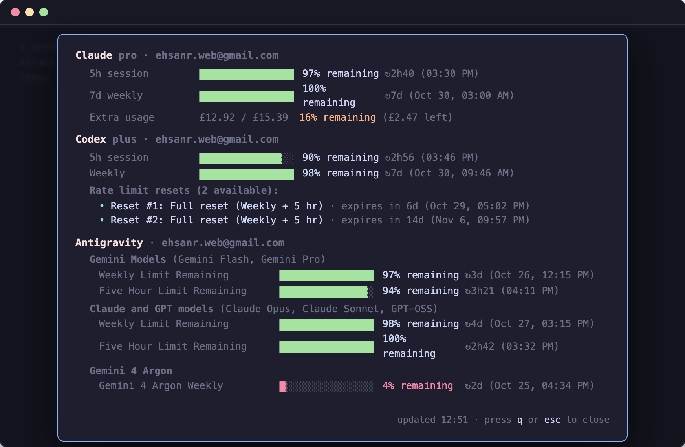

# herdr-usage-monitor

[](LICENSE)

**A space-efficient AI subscription allowance monitor for [Herdr](https://herdr.dev).**

Shows live **% remaining** right in Herdr's tab bar (zero extra panels, zero terminal grid waste), with an instant modal overlay (`prefix+u`) for full limit breakdowns, reset countdowns, and rate limit credits.

Supports Claude Code, OpenAI Codex, Antigravity CLI (AGY), Cursor, Grok, and GitHub Copilot.

---

### In the Terminal

#### 1. Top Right Tab Bar (Glanceable & Zero Grid Waste)


#### 2. On-Demand Modal Breakdown (`prefix + u` or `Ctrl+b u`)


---

## Highlights

* **Zero extra panels**: Fits cleanly on the right edge of Herdr's existing desktop tab bar (`tab_bar_right`).
* **Focused 5-Hour view**: Glance at `Claude 97% · Codex 90% · AGY 100%` directly in your tab bar without cluttering your workflow.
* **Inverted to % remaining**: Clearly shows how much allowance buffer you have left before limits or throttling.
* **Instant on-demand breakdown (0ms)**: Hit `prefix + u` to instantly display the modal overlay from warm cache without any startup lag. Shows a subtle `↻ refreshing…` indicator in the footer while revalidating fresh data in the background. Press `q` or `Esc` to close immediately, or `r` to manually refresh.
* **Background Polling Daemon**: Includes a background daemon (`bun monitor.ts`) that keeps usage caches warm in the background (every 3 minutes), keeping tab bar checks fast (<1ms) and popup brings instantaneous while respecting provider rate limits.
* **Deep Provider Details**:
  * **Claude**: 5h session, 7d weekly, and Extra usage spend balances with remaining amounts.
  * **Codex**: 5h and weekly limits, plus an itemized list of all available rate limit reset credits with exact expiration dates.
  * **Antigravity (AGY)**: All quota groups (Gemini Models, Claude & GPT 3p models, and Gemini 4 Argon) with exact local reset times and shared quota policy details.
* **Standalone & lightweight**: Zero external plugin dependencies — inspects local CLI credentials (read-only) and resolves in <1ms from the warm cache.

---

## Herdr app (desktop)

The native desktop mod puts the same allowance readout at the bottom of the sidebar, above Settings. Click it or press Cmd+U (Ctrl+Shift+U on Linux and Windows) to open the breakdown, then use **Refresh** for an immediate check. The mod shares the TUI monitor’s provider code and cache.


The breakdown uses traffic lights to show where allowance will reset unused. Each limit's time left is compared with its allowance left:

- 🟢 **Untapped**: at least 20 points more allowance left than time left, so at your current pace some of it resets unused. Codex reset credits that expire within 3 days count too. The **Untapped allowance** panel at the top lists all of these, soonest reset first.
- 🟡 **On pace**: within 20 points either way.
- 🔴 **Tight**: 10% or less left, or 20 points behind, so it runs out before the reset.

A tick on each bar marks where an even pace would be.

### Install

The mod needs [Bun](https://bun.sh). Open Herdr once, then pick one of these:

- **With the installer** (from this checkout):

  ```sh
  bun herdr-app/install.ts --bind-key
  ```

  It copies the mod, binds Cmd+U (`--bind-key`, optional), and adds the readout to a layout: the personal layout on screen if you have one open (`main-context` from [herdr-context-monitor](https://github.com/EMRahman/herdr-context-monitor), say), otherwise its own `herdr-with-usage`. Switch to it with `herdr-app do layout.switch '{"name":"herdr-with-usage"}'` or the layout picker.
- **By hand**, as with any Herdr mod: copy `herdr-app/mods/usage-monitor/` into `~/.config/herdr-app/mods/`, merge `herdr-app/keys.json` into yours, and add the block from [`herdr-app/RECIPE.md`](herdr-app/RECIPE.md) to a personal layout. Or ask your agent to add it from the recipe.

Binding the key edits `keys.json`, and Herdr stops adding new default shortcuts to an edited keys file on upgrade. Without it, clicking the readout opens the breakdown.

### Choosing the layout

Herdr shows one layout at a time, so mods that each add a panel share a personal layout. Pass `--layout <name>` to pick one. Later runs remember the choice, and `--layout herdr-with-usage` moves the readout back to its own layout. The installer only adds its block to a layout it didn't make, and never rebuilds it.

### Updating

Like other Herdr mods, this one doesn't update itself. Rerun the installer after pulling changes or updating Herdr. A rerun only writes what changed. It rebuilds `herdr-with-usage` from Herdr's current main layout, unless you've edited that layout since. Blocks other mods added don't count as edits, and a rebuild keeps them in place.

While the readout shows, the app checks the cache every minute and refreshes allowances when the cached report is at least three minutes old. The optional TUI poller also keeps this cache warm.

### Developing

`herdr-app/mods/usage-monitor/bridge.js` is the provider code prebuilt for the mod. After changing `fetcher.ts`, `providers.ts` or `usage-summary.ts`, rebuild it, and check it before committing:

```sh
bun run build:mod     # rebuild bridge.js
bun run check:mod     # fail if bridge.js is out of date
```

The installer also rebuilds it on every run.

## Setup in Herdr TUI

Clone the repository to your preferred location (e.g., `~/Code/herdr-usage-monitor` or `~/.config/herdr/plugins/herdr-usage-monitor`):

```bash
git clone https://github.com/EMRahman/herdr-usage-monitor.git ~/Code/herdr-usage-monitor
cd ~/Code/herdr-usage-monitor
bun install # (if needed)
```

Add the following to your Herdr configuration at `~/.config/herdr/config.toml` (adjust `~/Code/herdr-usage-monitor` to match your clone path).

> **Important:** Herdr runs commands with a minimal `PATH`, so a bare `bun` often fails with `exit status: 127` (command not found). Replace `/path/to/bun` below with the absolute path from `which bun` (e.g. `~/.bun/bin/bun`, `~/.local/bin/bun`, or `/opt/homebrew/bin/bun`).

### 1. Tab Bar Status (`tab_bar_right`)

```toml
[ui]
# Desktop tab row placement: "top" or "bottom"
tab_bar_position = "top"

# Show live provider remaining % at the right edge of the tab bar
tab_bar_right = [
  { type = "command", command = "/path/to/bun ~/Code/herdr-usage-monitor/usage-bar.ts", interval_seconds = 60, timeout_seconds = 2 }
]
tab_bar_right_separator = " · "
```

### 2. On-Demand Modal Breakdown (`keys.command`)

```toml
[[keys.command]]
key = "prefix+u"
type = "popup"
command = "/path/to/bun ~/Code/herdr-usage-monitor/usage-pane.ts"
description = "Show subscription usage breakdown"
width = "65%"
height = "65%"
```

### 3. Background Poller Daemon (Optional, for 0ms instant brings)

To keep the cache warm in the background:

```bash
# Run in background via nohup:
nohup bun ~/Code/herdr-usage-monitor/monitor.ts > /dev/null 2>&1 &

# Or link as a managed Herdr plugin so Herdr supervises it on startup:
herdr plugin link ~/Code/herdr-usage-monitor
```

Then reload Herdr's configuration:
```bash
herdr server reload-config
```

---

## Usage

* **Glance**: Look at the top right of your Herdr terminal window to see current 5h allowances (`Claude 97% · Codex 90% · AGY 100%`).
* **Inspect Details**: Press `Ctrl+b` then `u` (or your custom prefix key) to open the modal breakdown.
* **Dismiss Details**: Press `q`, `Esc`, or `Enter` to close the popup and return to your terminal panes.

---

## CLI Commands

You can also run the monitor directly from your shell:

```bash
# Print single-line status for the tab bar
bun usage-bar.ts

# Print full breakdown once to stdout
bun usage-pane.ts --once

# Run interactive terminal viewer (dismiss with q or Esc)
bun usage-pane.ts
```

---

## License

MIT © 2026 Ehsan Rahman
