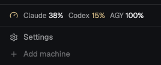
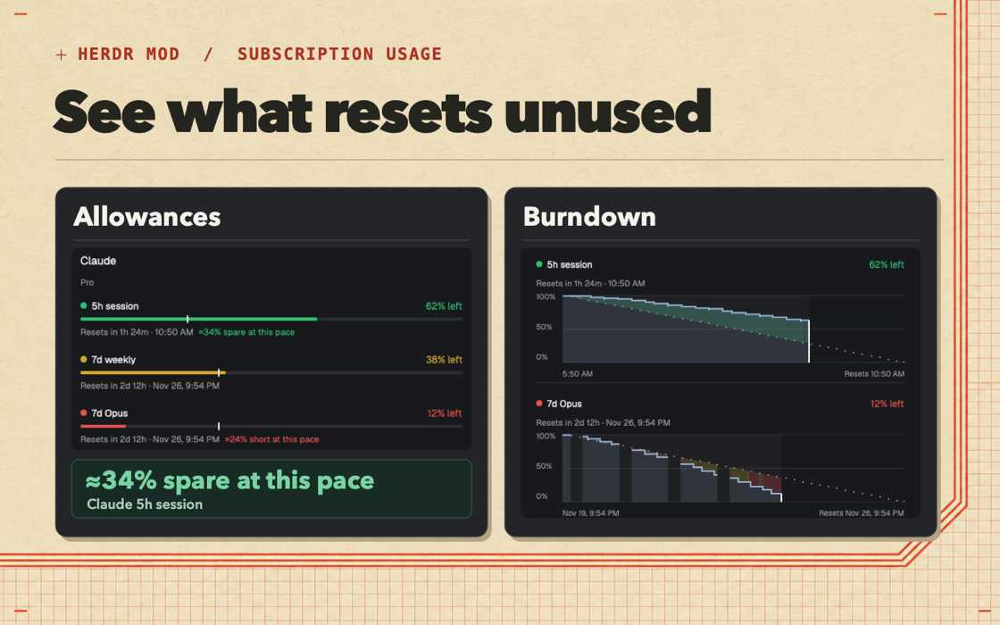
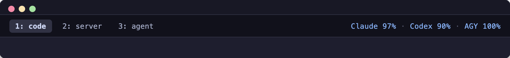

# Herdr Usage Monitor

**See how much of your AI subscriptions is left, and where allowance is about to go unused, without leaving [Herdr](https://herdr.dev).**

Claude Code · Codex · Antigravity · Cursor · GitHub Copilot · Grok · OpenCode

[](LICENSE)
[](https://herdr.dev/mods)
[](https://bun.sh)

**Always on screen.** What's left of each subscription sits at the bottom left of the Herdr app's sidebar, above Settings. A figure turns yellow at 30% or less and red at 10% or less.



**One shortcut for the full breakdown.** Press <kbd>Cmd</kbd>+<kbd>U</kbd>, or click the readout, to see every limit, when it resets, and where allowance is going unused:



## Pick your Herdr

|  | **Herdr app** (desktop) | **Herdr** (terminal) |
|---|---|---|
| **At a glance** | Bottom left of the sidebar, above Settings | Right edge of the tab bar |
| **Full breakdown** | <kbd>Cmd</kbd>+<kbd>U</kbd>, or click the readout | <kbd>prefix</kbd> then <kbd>u</kbd> |
| **Traffic lights for unused allowance** | ✅ | n/a |
| **Install** | [One command](#quick-start-herdr-app) | [Two config entries](#quick-start-herdr-terminal) |

## Quick start: Herdr app

You need the [Herdr app](https://herdr.dev) (opened at least once), [Bun](https://bun.sh), and at least one supported AI CLI you're signed in to.

```sh
git clone https://github.com/EMRahman/herdr-usage-monitor.git
cd herdr-usage-monitor
bun herdr-app/install.ts --bind-key
```

That's it. The readout appears at the bottom left of the sidebar, above Settings.

- **If you don't see it**, switch layouts with <kbd>Ctrl</kbd>+<kbd>Shift</kbd>+<kbd>L</kbd>. The installer prints the layout's name: the personal layout you had open, or its own `herdr-with-usage`.
- **Open the breakdown** with <kbd>Cmd</kbd>+<kbd>U</kbd> (<kbd>Ctrl</kbd>+<kbd>Shift</kbd>+<kbd>U</kbd> on Linux and Windows), or click the readout.
- **Without a shortcut:** leave out `--bind-key` and click the readout instead. The flag edits Herdr's `keys.json`, and Herdr stops adding new default shortcuts to an edited keys file.

To update, `git pull` and run the installer again.

## Quick start: Herdr (terminal)

Clone the repo, then add this to `~/.config/herdr/config.toml`. Replace `/path/to/bun` with the output of `which bun`, because Herdr runs commands with a minimal `PATH`:

```toml
[ui]
tab_bar_right = [
  { type = "command", command = "/path/to/bun ~/Code/herdr-usage-monitor/usage-bar.ts", interval_seconds = 60, timeout_seconds = 2 }
]
tab_bar_right_separator = " · "

[[keys.command]]
key = "prefix+u"
type = "popup"
command = "/path/to/bun ~/Code/herdr-usage-monitor/usage-pane.ts"
description = "Show subscription usage breakdown"
width = "65%"
height = "65%"
```

Reload with `herdr server reload-config`. The tab bar shows `Claude 97% · Codex 90% · AGY 100%`, and <kbd>prefix</kbd> then <kbd>u</kbd> opens the breakdown. Close it with <kbd>q</kbd> or <kbd>Esc</kbd>, or press <kbd>r</kbd> to refresh.

| Tab bar | Breakdown |
|---|---|
|  |  |

<details>
<summary><b>Keep the cache warm in the background</b> (optional)</summary>

A small poller refreshes every 3 minutes, so the tab bar and popup always open from a fresh cache:

```sh
herdr plugin link ~/Code/herdr-usage-monitor   # Herdr starts and supervises it
# or
nohup bun ~/Code/herdr-usage-monitor/monitor.ts > /dev/null 2>&1 &
```

The Herdr app mod shares the same cache, so this helps both.
</details>

## Spot unused allowance

Every limit resets on a clock. If you used it evenly, the share left would match the share of time left. The Herdr app's breakdown compares the two and lights each limit:

| Light | Meaning |
|---|---|
| 🟢 **Untapped** | At least 20 points more allowance left than time left: at this pace, some of it resets unused. Also Codex reset credits expiring within 3 days. |
| 🟡 **On pace** | Within 20 points either way. |
| 🔴 **Tight** | 10% or less left, or 20 points behind: it runs out before the reset. |

Everything green is listed in the **Untapped allowance** panel at the top, soonest reset first. A white tick on each bar marks where an even pace would be.

## What it shows

| Provider | Limits |
|---|---|
| **Claude Code** | 5-hour session, 7-day weekly, and Extra usage spend with balance |
| **Codex** | 5-hour and weekly limits, plus each reset credit with its expiry |
| **Antigravity** | Every quota group (Gemini models, Claude & GPT models, Gemini 4 Argon) with reset times |
| **Cursor, GitHub Copilot, Grok, OpenCode** | The session, daily, weekly or monthly limits and credits each one reports |

Providers you aren't signed in to are left out.

## Privacy

- **Sign-ins are only read.** It reads each CLI's existing sign-in on your machine, from its config files or the macOS Keychain, and never changes them. The first time it runs, macOS may ask you to allow Keychain access.
- **It connects only to the providers themselves:** Anthropic, OpenAI and ChatGPT, GitHub, Cursor, Google, Grok and OpenCode, to read your usage. It has no server of its own and sends nothing anywhere else.
- **Results are cached** in `~/.cache/herdr-usage-monitor/` and shared by the tab bar, the popup and the app, so the providers aren't asked on every check.

## Troubleshooting

| Problem | Fix |
|---|---|
| The installer says to open Herdr first | Open the Herdr app once so it creates `~/.config/herdr-app`, then run the installer again. |
| The readout says **Usage unavailable**, or its gauge is red | Hover it to see why. |
| "Couldn't find Bun" | Install [Bun](https://bun.sh), then reopen Herdr. |
| A provider is missing | Sign in to its CLI, then press **Refresh** in the breakdown. |
| `exit status: 127` in the terminal tab bar | Use the full path from `which bun` in `config.toml`. |

<details>
<summary><b>More ways to install the Herdr app mod</b></summary>

**By hand**, like any Herdr mod: copy `herdr-app/mods/usage-monitor/` into `~/.config/herdr-app/mods/`, merge `herdr-app/keys.json` into yours, and add the block described in [`herdr-app/RECIPE.md`](herdr-app/RECIPE.md) to one of your own layouts. Or ask your agent to add it from the recipe.

**Choosing the layout.** Herdr shows one layout at a time, so mods that each add a panel share one of your own layouts. The installer joins the personal layout on screen, or makes `herdr-with-usage` from Herdr's main layout. Pass `--layout <name>` to pick another. Later runs remember the choice, and `--layout herdr-with-usage` moves the readout back. In a layout the installer didn't make, it only adds its own block.

**Updating.** Like other Herdr mods, this one doesn't update itself. Run the installer again after `git pull` or a Herdr update. It only writes what changed. It rebuilds `herdr-with-usage` from Herdr's current main layout unless you've edited that layout, and it keeps other mods' blocks in place.

**Refresh timing.** While the readout shows, the mod checks the cache every minute and asks the providers when the cache is 3 minutes old.
</details>

<details>
<summary><b>Command line</b></summary>

```sh
bun usage-bar.ts            # one-line status, as in the tab bar
bun usage-pane.ts --once    # full breakdown, printed once
bun usage-pane.ts           # interactive breakdown (q or Esc to close)
```
</details>

<details>
<summary><b>Developing</b></summary>

`herdr-app/mods/usage-monitor/bridge.js` is the provider code prebuilt for the Herdr app mod. After changing `fetcher.ts`, `providers.ts` or `usage-summary.ts`, rebuild it, and check it before committing:

```sh
bun run build:mod     # rebuild bridge.js
bun run check:mod     # fail if bridge.js is out of date
```

The installer also rebuilds it on every run. Check the mod itself with `herdr-app check herdr-app/mods/usage-monitor`.
</details>

## License

MIT © 2026 Ehsan Rahman
