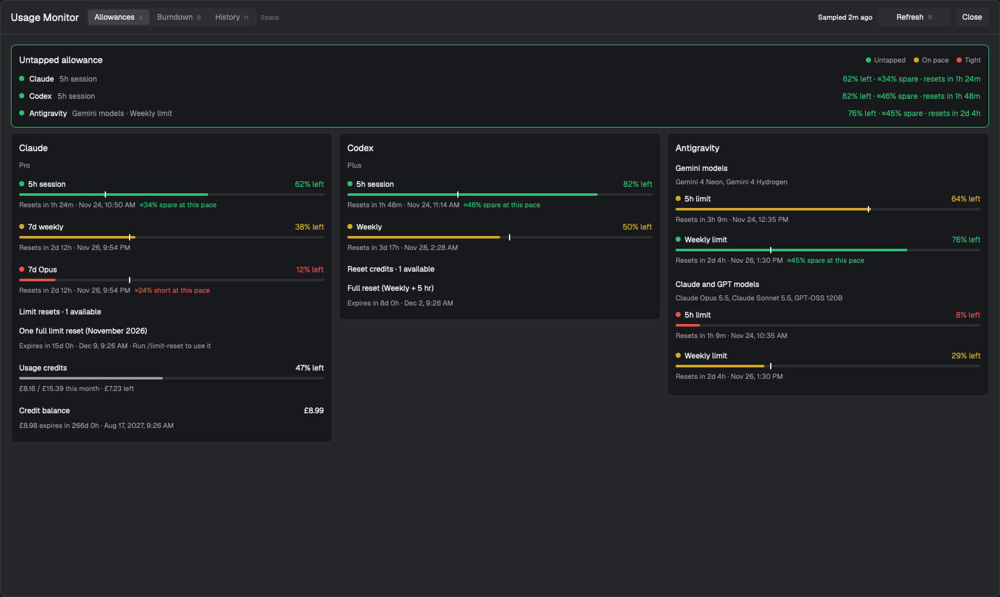

# Herdr Usage Monitor

**See which AI subscription is running tight and which will reset with quota to spare in the [Herdr desktop app](https://herdr.dev).**

Claude Code · Codex · Antigravity · Cursor · GitHub Copilot · Grok · OpenCode

[](LICENSE)
[](https://herdr.dev/gallery/?type=mods)
[](https://bun.sh)


**Always on screen.** What's left of each subscription sits at the bottom left of the Herdr app's sidebar, above Settings. A figure turns yellow at 30% or less and red at 10% or less.


**One shortcut for the full breakdown.** Press <kbd>Cmd</kbd>+<kbd>U</kbd>, or click the readout, to see every limit, when it resets, and where allowance is going unused:



Press <kbd>B</kbd> (or <kbd>Space</kbd>, which toggles between the two views) to switch to the **Burndown** view, which charts how each limit has drained through its current window against an even pace (see [Burndown charts](#burndown-charts)):


## Quick start

You need the [Herdr app](https://herdr.dev) (opened at least once), [Bun](https://bun.sh), and at least one supported AI CLI you're signed in to.

```sh
git clone https://github.com/EMRahman/herdr-usage-monitor.git
cd herdr-usage-monitor
bun herdr-app/install.ts --bind-key
```

That's it. The readout appears at the bottom left of the sidebar, above Settings.

- **If you don't see it**, switch layouts with <kbd>Ctrl</kbd>+<kbd>Shift</kbd>+<kbd>L</kbd>. The installer prints the layout's name: the personal layout you had open, or its own `herdr-with-usage`.
- **Open the breakdown** with <kbd>Cmd</kbd>+<kbd>U</kbd> (<kbd>Ctrl</kbd>+<kbd>Shift</kbd>+<kbd>U</kbd> on Linux and Windows), or click the readout. In it, <kbd>R</kbd> refreshes, <kbd>B</kbd> shows the burndown charts and <kbd>U</kbd> the usage again.
- **Without a shortcut:** leave out `--bind-key` and click the readout instead. The flag edits Herdr's `keys.json`, and Herdr stops adding new default shortcuts to an edited keys file.

To update, `git pull` and run the installer again.

The terminal plugin has been retired. If you installed it, remove its status command and shortcut from your terminal Herdr config and stop any linked plugin or standalone poller.

## Spot unused allowance

Every limit resets on a clock. If you used it evenly, the share left would match the share of time left. The Herdr app's breakdown compares the two and lights each limit:

| Light | Meaning |
|---|---|
| 🟢 **Untapped** | At least 20 points more allowance left than time left: at this pace, some of it resets unused. Also Codex reset credits expiring within 3 days. |
| 🟡 **On pace** | Within 20 points either way. |
| 🔴 **Tight** | 10% or less left, or 20 points behind: it runs out before the reset. |

Everything green is listed in the **Untapped allowance** panel at the top, soonest reset first. A white tick on each bar marks where an even pace would be.

## Burndown charts

Switch the breakdown to **Burndown** (press <kbd>B</kbd>, and <kbd>U</kbd> to go back, or <kbd>Space</kbd> to toggle) to see how each 5-hour and weekly limit has drained through its current window, from 100% at the start to the reset. Claude’s 7d Opus and 7d Sonnet limits have their own charts, and Antigravity shows one chart per 5-hour or weekly limit in each model group. A dotted line shows an even pace to 0% at the reset. Faint shading extends from the start of the window to the vertical marker at the current time, so you can see how far through the window you are. The area between the allowance line and the dotted line is shaded to show how far ahead or behind an even pace each reading was: green when ahead (allowance that would go unused at that pace), yellow when a little behind, and red when 20 or more points behind. Hover a chart for the allowance reading. On Claude, Codex and Antigravity charts, the tooltip also lists models and reasoning efforts logged in that part of the timeline.

The charts come from readings kept on your machine, recorded each time allowances are read (every few minutes while Herdr is open), so they fill in from when you install this version. Time when Herdr was closed or the machine was asleep shows as a gap.

Upgrading from the JSONL version starts a fresh chart history in `history.sqlite`. Your previous readings remain available in `history.jsonl` in the same directory.

## What it shows

| Provider | Limits |
|---|---|
| **Claude Code** | 5-hour session, 7-day weekly, and Extra usage spend with balance |
| **Codex** | 5-hour and weekly limits, plus each reset credit with its expiry |
| **Antigravity** | Every quota group (Gemini models, Claude & GPT models, Gemini 4 Argon) with reset times |
| **Cursor, GitHub Copilot, Grok, OpenCode** | The session, daily, weekly or monthly limits and credits each one reports |

Providers you aren't signed in to are left out.

## Privacy

- **Sign-ins are only read.** It reads each CLI's existing sign-in on your machine, from its config files or the macOS Keychain, and never changes them. The first time it runs, macOS may ask you to allow Keychain access.
- **It connects only to the providers themselves:** Anthropic, OpenAI and ChatGPT, GitHub, Cursor, Google, Grok and OpenCode, to read your usage. It has no server of its own and sends nothing anywhere else.
- **Results are cached** in `~/.cache/herdr-usage-monitor/` and shared by the sidebar and breakdown, so the providers aren't asked on every check.
- **History stays on your machine** in `~/.local/share/herdr-usage-monitor/history.sqlite` (under `$XDG_DATA_HOME` when set). Allowance readings and collected model activity are kept indefinitely. Allowance readings include the time, remaining percentage, reset time, and a hashed account identifier when available.
- **Model activity** is recorded from local Codex, Claude Code and Antigravity session logs. SQLite stores the reported model ID, timestamp, reasoning effort when available, and a hashed event ID. The collector picks up events written in the last eight days. Deleting `history.sqlite` while Herdr is closed clears the database. The next poll can pick up recent model activity again from the logs.

## Troubleshooting

| Problem | Fix |
|---|---|
| The installer says to open Herdr first | Open the Herdr app once so it creates `~/.config/herdr-app`, then run the installer again. |
| The readout says **Usage unavailable**, or its gauge is red | Hover it to see why. |
| "Couldn't find Bun" | Install [Bun](https://bun.sh), then reopen Herdr. |
| A provider is missing | Sign in to its CLI, then press **Refresh** in the breakdown. |

<details>
<summary><b>More ways to install the Herdr app mod</b></summary>

**By hand**, like any Herdr mod: copy `herdr-app/mods/usage-monitor/` into `~/.config/herdr-app/mods/`, merge `herdr-app/keys.json` into yours, and add the block described in [`herdr-app/RECIPE.md`](herdr-app/RECIPE.md) to one of your own layouts. Or ask your agent to add it from the recipe.

**Choosing the layout.** Herdr shows one layout at a time, so mods that each add a panel share one of your own layouts. The installer joins the personal layout on screen, or makes `herdr-with-usage` from Herdr's main layout. Pass `--layout <name>` to pick another. Later runs remember the choice, and `--layout herdr-with-usage` moves the readout back. In a layout the installer didn't make, it only adds its own block.

**Updating.** Like other Herdr mods, this one doesn't update itself. Run the installer again after `git pull` or a Herdr update. It only writes what changed. It rebuilds `herdr-with-usage` from Herdr's current main layout unless you've edited that layout, and it keeps other mods' blocks in place.

**Refresh timing.** While the readout shows, the mod checks the cache every minute and asks the providers when the cache is 3 minutes old.
</details>

<details>
<summary><b>Developing</b></summary>

`herdr-app/mods/usage-monitor/bridge.js` is the provider code prebuilt for the Herdr app mod. After changing `fetcher.ts`, `providers.ts` or `usage-summary.ts`, rebuild it, and check it before committing:

```sh
bun run build:mod     # rebuild bridge.js
bun run check:mod     # fail if bridge.js is out of date
```

The installer also rebuilds it on every run. Run the tests with `bun test`. Check the mod itself with `herdr-app check herdr-app/mods/usage-monitor`.
</details>

## License

MIT © 2026 Ehsan Rahman
