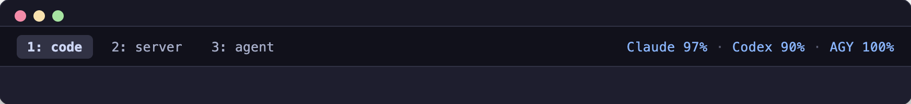
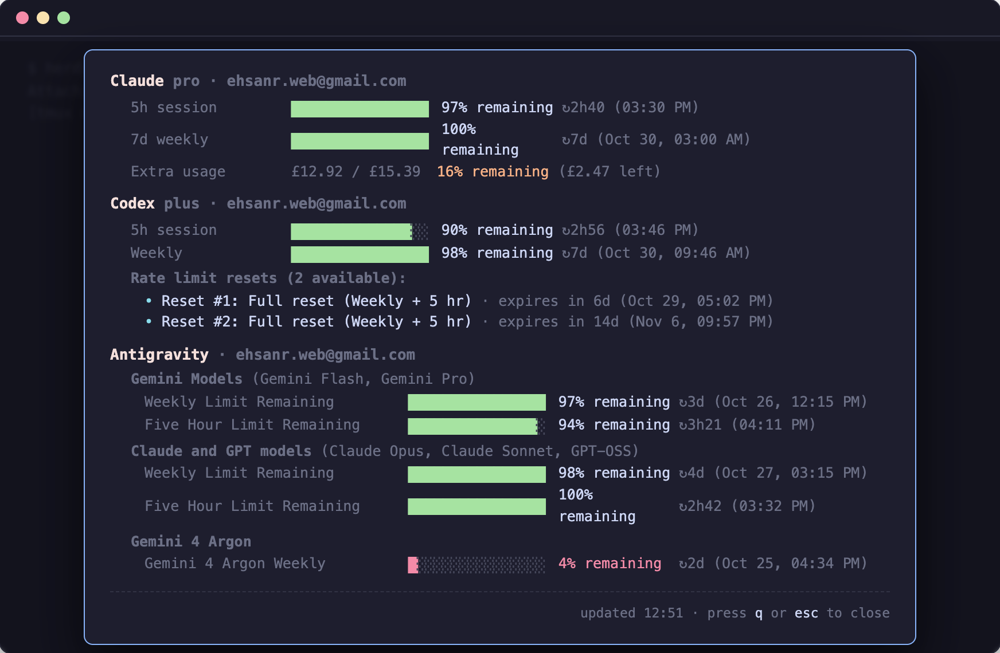

# herdr-usage-monitor

[](LICENSE)

**A space-efficient AI subscription allowance monitor for [Herdr](https://herdr.dev).**

Shows live **% remaining** right in Herdr's tab bar (zero extra panels, zero terminal grid waste), with an instant modal overlay (`prefix+u`) for full limit breakdowns, reset countdowns, and rate limit credits.

Supports Claude Code, OpenAI Codex, Antigravity CLI (AGY), Cursor, Grok, and GitHub Copilot.

---

### In the Terminal

#### 1. Top Right Tab Bar (Glanceable & Zero Grid Waste)


#### 2. On-Demand Modal Breakdown (`prefix + u` or `Ctrl+b u`)


---

## Highlights

* **Zero extra panels**: Fits cleanly on the right edge of Herdr's existing desktop tab bar (`tab_bar_right`).
* **Focused 5-Hour view**: Glance at `Claude 97% · Codex 90% · AGY 100%` directly in your tab bar without cluttering your workflow.
* **Inverted to % remaining**: Clearly shows how much allowance buffer you have left before limits or throttling.
* **Instant on-demand breakdown (0ms)**: Hit `prefix + u` to instantly display the modal overlay from warm cache without any startup lag. Shows a subtle `↻ refreshing…` indicator in the footer while revalidating fresh data in the background. Press `q` or `Esc` to close immediately, or `r` to manually refresh.
* **Background Polling Daemon**: Includes a background daemon (`bun monitor.ts`) that keeps usage caches warm every 60s, keeping tab bar checks fast (<1ms) and popup brings instantaneous.
* **Deep Provider Details**:
  * **Claude**: 5h session, 7d weekly, and Extra usage spend balances with remaining amounts.
  * **Codex**: 5h and weekly limits, plus an itemized list of all available rate limit reset credits with exact expiration dates.
  * **Antigravity (AGY)**: All quota groups (Gemini Models, Claude & GPT 3p models, and Gemini 4 Argon) with exact local reset times and shared quota policy details.
* **Fast & lightweight**: Resolves in ~12ms via the local `herdr-web-ui` bridge cache, falling back to direct CLI credential inspection when offline.

---

## Setup in Herdr

Add the following to your Herdr configuration at `~/.config/herdr/config.toml`:

### 1. Tab Bar Status (`tab_bar_right`)

```toml
[ui]
# Desktop tab row placement: "top" or "bottom"
tab_bar_position = "top"

# Show live provider remaining % at the right edge of the tab bar
tab_bar_right = [
  { type = "command", command = "bun /Users/ehsanrahman/Code/herdr-usage-monitor/usage-bar.ts", interval_seconds = 60, timeout_seconds = 2 }
]
tab_bar_right_separator = " · "
```

### 2. On-Demand Modal Breakdown (`keys.command`)

```toml
[[keys.command]]
key = "prefix+u"
type = "popup"
command = "bun /Users/ehsanrahman/Code/herdr-usage-monitor/usage-pane.ts"
description = "Show subscription usage breakdown"
width = "65%"
height = "65%"
```

Then reload Herdr's configuration:
```bash
herdr server reload-config
```

---

## Usage

* **Glance**: Look at the top right of your Herdr terminal window to see current 5h allowances (`Claude 97% · Codex 90% · AGY 100%`).
* **Inspect Details**: Press `Ctrl+b` then `u` (or your custom prefix key) to open the modal breakdown.
* **Dismiss Details**: Press `q`, `Esc`, or `Enter` to close the popup and return to your terminal panes.

---

## CLI Commands

You can also run the monitor directly from your shell:

```bash
# Print single-line status for the tab bar
bun usage-bar.ts

# Print full breakdown once to stdout
bun usage-pane.ts --once

# Run interactive terminal viewer (dismiss with q or Esc)
bun usage-pane.ts
```

---

## License

MIT © 2026 Ehsan Rahman
