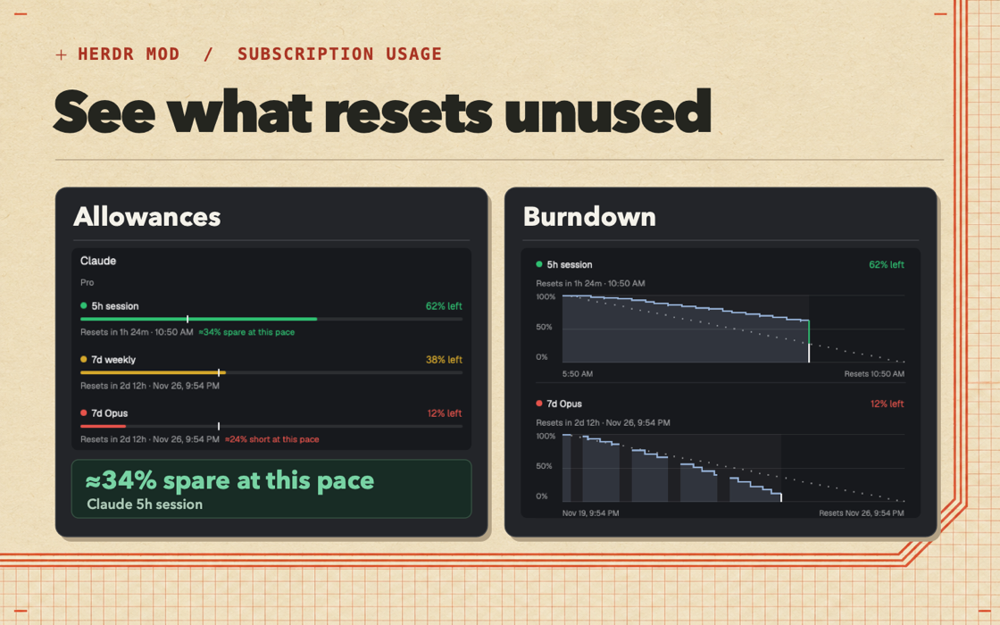

# Subscription Usage

See which AI subscription is running tight and which will reset with quota to
spare. Compare limits for Claude Code, Codex, Antigravity, Cursor, GitHub
Copilot, Grok, and OpenCode. Click the sidebar readout for reset times and
burndown charts that show how fast each allowance is draining.

## What you see

- **The readout** is a 36px block in the sidebar, directly above the
  Settings / Add machine footer, on the sidebar's `chrome` background with a
  1px `border` line above. One 28px row, 8px in from each side, like the
  footer's rows: a 14px gauge icon (`gauge.svg`), then each provider's name
  and % left in 12px text, 8px apart. Names are `muted`, figures are
  `foreground`; a figure at 30% or less is yellow (`ansi3`) and at 10% or less
  red (`blocked`). The icon takes the colour of the lowest figure, `muted`
  when all are healthy and `blocked` on an error.
- **On the folded sidebar rail** (under 160px wide), only the gauge shows,
  centred, with the same colour.
- **The breakdown** is a dialog covering 90% of the window, `popover`
  background, 12px text:
  - A header with "Subscription usage" (16px semibold) and Refresh and Close
    buttons (28px high, `raised`).
  - An **Untapped allowance** panel across the full width (a card with a green
    border when anything is listed): every untapped window, soonest reset
    first, as `● Claude  5h session ··· 47% left · ≈27% spare · resets in 1h 0m`.
    A legend at the right: ● Untapped ● On pace ● Tight. With nothing
    untapped it says "Nothing is going unused: every allowance is on pace or
    tight."
  - One card per provider (`surface`, 8px radius, 1px `border`), in as many
    columns as fit at 360px or more each; each card goes to the shortest column.
    A card lists its plan, then each limit: a light dot, its name, "N% left" in
    the light's colour, a 4px bar filled to the % left in that colour, a white
    2px tick where an even pace would be, and a caption with the reset
    countdown and time ("Resets in 1h 0m · 12:20 PM", or "Nov 25, 8:58 AM" on
    another day), plus "≈27% spare at this pace" or "≈24% short at this pace".
  - Antigravity groups its limits under each model group's name and models.
    Codex lists its reset credits with their expiry. Claude's Extra usage shows
    the spend and balance with a grey bar and no light.
  - A footer: "Updated · 11:20 AM", "Cached · …" when older than 5 minutes,
    "Refreshing allowances…" while reading, or the error in red.

- **Burndown**, the dialog's second view (an `Allowances | Burndown` switch
  beside the title, the chosen one on `selected`): an intro line, then one card
  per provider with a chart for each 5-hour and weekly limit, model-specific
  ones too (Claude's 7d Opus and 7d Sonnet, each Antigravity model group).
  - Each chart has a header like the breakdown's rows (light dot, name,
    "N% left") and the reset countdown, then an 88px plot with a 34px gutter
    of "100% / 50% / 0%" labels and 1px `border` grid lines at those levels.
  - The x axis is the current window: its reset minus its length, to its
    reset. With no reset time (Claude's 5-hour limit before a session), it
    ends now. Under the plot: the start time at left, "Resets <time>" or
    "Now" at right.
  - % left is a step line of 2px `accent` bars with `accent` at 14% opacity
    under it. Time with no readings is a gap. A dotted `muted` diagonal runs
    from 100% at the start to 0% at the reset: an even pace. The time already
    gone in the window (start to now) has a faint `foreground` tint at 3.5%
    opacity behind everything, so how far through it you are shows at a
    glance; the time still to come stays clear. At the current
    time, a 2px white marker extends from the remaining allowance to the
    bottom of the plot. The part above the dotted line is green (`#2fbf71`)
    to show allowance that would go unused at this pace.
  - Hovering the plot shows "3:40 PM · 62% left · even pace 55%" for that
    48th of the window. Claude and Codex tooltips also show the local model
    and reasoning effort combinations logged in that time slice.

## How it behaves

- **Traffic lights.** A window's length comes from its label (5h, 7d / weekly,
  daily, monthly). Its time left as a share of that length is where an even
  pace would put the allowance. More allowance left than time left means
  capacity will go unused:
  - 🟢 **Untapped** (`#2fbf71`): 20 or more points more allowance than time
    left. Also a Codex reset credit expiring within 3 days.
  - 🟡 **On pace** (`#d4a72c`): within 20 points either way.
  - 🔴 **Tight** (`#e5534b`): 10% or less left, or 20 or more points behind,
    so it runs out before the reset.
  - A window with no reset time or unknown length goes by what's left: 70% or
    more is untapped, 25% or less is tight.
  The colours are fixed, not the theme's, so their meaning never changes.
- **Clicking the readout** or **Cmd+U** opens the breakdown; doing it again,
  Esc, Close or a click outside closes it.
- **Refresh** asks every provider now. It's greyed out while a read is running.
- **Keys in the breakdown:** it takes the keyboard when it opens. R refreshes,
  B switches to Burndown and U back to Allowances, and Space toggles between
  them; each button shows its key in `dim` 10px text, with a Space hint beside
  the view switch. Cmd+U and Esc still close it.
- **Polling.** Each copy of the mod checks every 60s. The bridge answers from a
  shared cache and only asks the providers when the cache is 3 minutes old, so
  the readout and breakdown share recent results.
- On start, the readout shows the last cached report (up to a day old) at once,
  then refreshes.
- **History.** Fresh readings go into `allowance_readings` in
  `~/.local/share/herdr-usage-monitor/history.sqlite` (under `$XDG_DATA_HOME`
  when set). Each row holds a provider, its read time in milliseconds, and
  the limit samples as JSON. Each sample's optional account ID is the first 10 hex digits of the
  account's SHA-256, so each account keeps its own line without the file naming
  it; when a provider has more than one, the charts add the account's name from
  the current report. The report's `read_at` says when each
  provider's figures were read; figures carried over from an older report keep
  their time. A transaction records each provider read time once, and the
  database keeps those readings indefinitely. While Burndown is on screen,
  the dialog reads the last eight days on opening it and after each poll.
- **Model activity.** Normal bridge polls collect recent metadata from the
  local Codex and Claude Code logs. `model_usage` holds the model ID and reasoning
  effort per recorded Codex turn or Claude API response, with a timestamp in
  milliseconds and a hashed event ID. Effort is empty when the log omits it.
  The table is indexed by time and by provider, model, and effort. These rows
  are kept for later analysis. Session log content stays in the source logs.
- Hovering the readout shows the full summary, or the error.

## Built from

- **Layout:** one block, `{"id": "usage-monitor", "type": "block", "size":
  {"px": 36}, "content": {"mod": "usage-monitor"}}`, inserted into the sidebar
  column directly before `sidebar-footer`. Herdr's shipped layouts are
  read-only, so it goes into a personal layout: your own, one another mod made
  (`main-context` from context-monitor, say), or a clone of `main`
  (`herdr-app do layout.clone '{"name":"main","as":"herdr-with-usage"}'`).
- **`mods/usage-monitor/`:**
  - `mod.json`: `{"place": "none", "overlay": {"width": 0.9, "height": 0.9}}`.
  - `main.js`: the readout (in a layout block) and the breakdown (as the
    overlay, when `props().overlay` is set). Data lives at module scope, shared
    by both copies; each change calls `setShared("usage-monitor.revision", …)`
    so every copy redraws. Uses `exec`, `readTextFile`, `appHome`, `home`,
    `layout` (to tell the rail), `run("mod.open")`, `closeOverlay`, `setShared`,
    `theme`, `checking`, `cx.timer.every`, `.on_size_change`.
  - `breakdown.js`: the dialog. `burndown.js`: the charts. `pace.js`: the
    traffic-light rules. `time.js`: times and durations.
  - `bridge.js`: the provider code, prebuilt by `build.ts`. It
    prints `{report, summary, parts}` as JSON: `--cached` returns whatever's
    cached, no flag refreshes a cache 3 minutes old, `--refresh` asks now.
    `--history` prints `{burndowns, modelUsage}` with allowance runs for each
    limit's current window and timestamped model activity from SQLite.
  - `gauge.svg`: the icon.
- **Programs:** Bun runs `bridge.js`. The mod tries `bun` on Herdr's PATH, then
  `config.json`'s `bun` (written by the installer), then `~/.bun/bin/bun`,
  `/opt/homebrew/bin/bun` and `/usr/local/bin/bun`.
- **What it reads:** the bridge reads each provider CLI's local sign-in (Claude
  Code, Codex, Antigravity, Cursor, Copilot, Grok, OpenCode) and asks their
  usage endpoints over the network. It writes its cache to
  `~/.cache/herdr-usage-monitor/` and its history to
  `~/.local/share/herdr-usage-monitor/`.
- **`keys.json`:** binds `cmd-u` to `mod.open:usage-monitor` (`global`).
- **Optional helper:** the repository's `herdr-app/install.ts` copies the mod,
  writes `config.json`, adds the block and binds the key with `--bind-key`. See
  the repository README.

## Watch out

- **Requests belong to each copy.** Herdr cancels a copy's pending `exec` calls
  when it closes or reloads, so a request shared between copies can never
  settle and blocks the rest. Share the results, not the promise. A busy flag
  older than 50s is treated as left over.
- **Dates are formatted by hand.** Herdr's script runtime ignores
  `toLocaleString`'s options and prints "11/25/2026, 08:58:15 AM".
- **Saving any file in the mod folder reloads it**, including `config.json` and
  `bridge.js`. Write only what changed, and add the layout block last, so the
  readout starts with every file in place.
- **Sharing a layout with other mods:** only insert your block, never wrap other
  nodes. A block showing a mod that is neither yours nor in Herdr's
  `installed.json` belongs to another mod: it isn't a hand edit, and rebuilding
  from `main` puts it back beside the same neighbours.
- The readout fits a 268px sidebar with three providers. Narrower, it clips.
- Cmd+U is macOS. On Linux and Windows use `ctrl-shift-u`.
- Needs Bun installed. Providers you're not signed in to are left out.

## Done when

- `herdr-app check herdr-app/mods/usage-monitor` passes from the repository root.
- `bun herdr-app/mods/usage-monitor/bridge.js --cached` prints JSON with a `summary`.
- The readout shows each signed-in provider's % left above Settings within a
  few seconds, and its tooltip shows the full summary.
- Folding the sidebar leaves only the gauge, coloured by the lowest figure.
- Cmd+U and clicking the readout open the breakdown; Cmd+U again closes it.
- A window with much more allowance left than time left shows green and appears
  in Untapped allowance; the tick on its bar sits left of the fill.
- Refresh greys out, the footer says "Refreshing allowances…", then "Updated"
  with the current time.
- Closing the breakdown during a refresh, then reopening it, still loads.
- After a few reads, Burndown shows a line in each 5-hour and weekly chart,
  ending at the now marker, and hovering it shows the reading there.
